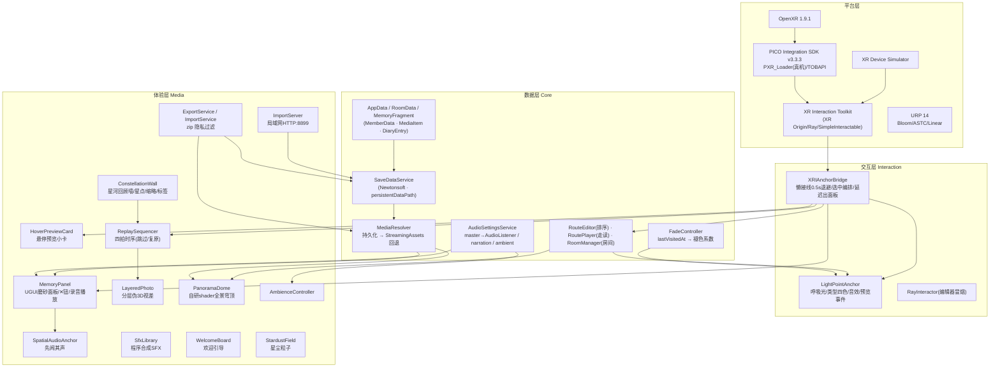
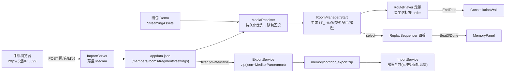
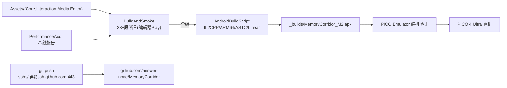

# 架构图（ARCHITECTURE v1.1）

> 生成：R3 · 与代码同步维护（改动涉及架构层必须更新本图）
> 代码入口：`Assets/Scripts/{Core,Interaction,Media}` + `Assets/Editor`（工具链）

---

## 1. 分层架构（运行时）

## 2. 数据流（内容生命周期）

## 3. 构建与质量管线

## 4. 模块职责速查

| 模块 | 文件 | 一句话职责 |
|---|---|---|
| 根数据 | Core/AppData.cs | 成员+房间+设置+导出清单 |
| 存档 | Core/SaveDataService.cs | appdata.json 读写（Newtonsoft，主线程路径缓存 坑-024） |
| 素材解析 | Core/MediaResolver.cs | 持久化→StreamingAssets 两级查找 |
| 音量 | Core/AudioSettingsService.cs | 三路音量单一消费点 |
| 排序 | Core/RouteEditor.cs | order 交换落盘 |
| 走读 | Core/RoutePlayer.cs | 路线+信标+MarkVisited 回访 |
| 房间 | Core/RoomManager.cs | 光点生成/穹顶/环境音/切换 |
| 褪色 | Core/FadeController.cs | 天数→系数→光点/低通 |
| 光点 | Interaction/LightPointAnchor.cs | 呼吸光/配色/音效/事件 |
| 桥接 | Interaction/XRIAnchorBridge.cs | XRI→契约编排（全组件引用枢纽） |
| 面板 | Media/MemoryPanel.cs | UGUI 磨砂+录音+✕ |
| 预览 | Media/HoverPreviewCard.cs | 悬停小卡 |
| 重演 | Media/ReplaySequencer.cs | 四拍+LastPlaySource 分流 |
| 星河墙 | Media/ConstellationWall.cs | 弧形星座+点星重演 |
| 分层 | Media/LayeredPhoto.cs | 三层视差 |
| 穹顶 | Media/PanoramaDome.cs | appdata 驱动全景 |
| 导入 | Media/ImportServer.cs | HTTP:8899 上传 |
| 导出/导入包 | Core/ExportService·ImportService | zip+隐私过滤（R3 新增） |
| 引导 | Media/WelcomeBoard.cs | 三句告示牌 |
| 粒子 | Media/StardustField.cs | 跟随相机星尘 |
| 音效 | Media/SfxLibrary.cs | 程序合成 SFX（R3 新增） |
| 工具 | Editor/SetupWizard · LightPointSceneBuilder · AndroidBuildScript · PerformanceAudit | 环境/场景/构建/审计 |

## 5. 关键设计决策（索引）

| 决策 | 位置 |
|---|---|
| Newtonsoft 替代 JsonUtility | MEMORY 坑-004 |
| 自研穹顶 shader（URP 内置天空盒失效） | 坑-022 |
| Android 仅留 PXR_Loader（libopenxr_loader 撞库） | 坑-033 |
| 跨对象引用走 Configure 序列化字段 | 坑-026 |
| SNI 阻断→SSH:443 通道 | 坑-035 |
| 运行时状态 Play 时从数据源重建 | 坑-018 |
